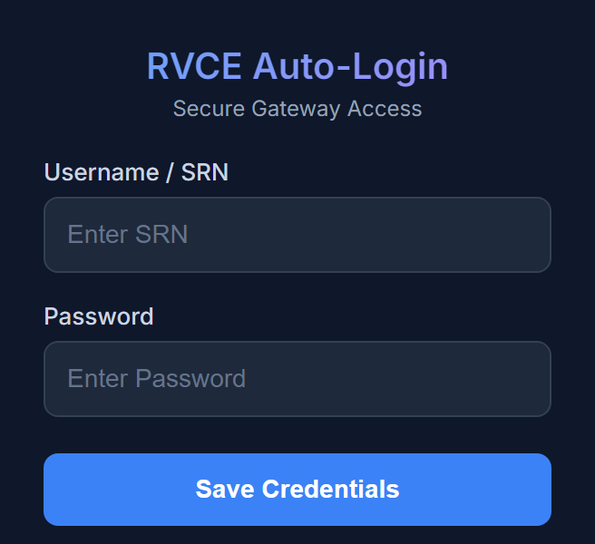
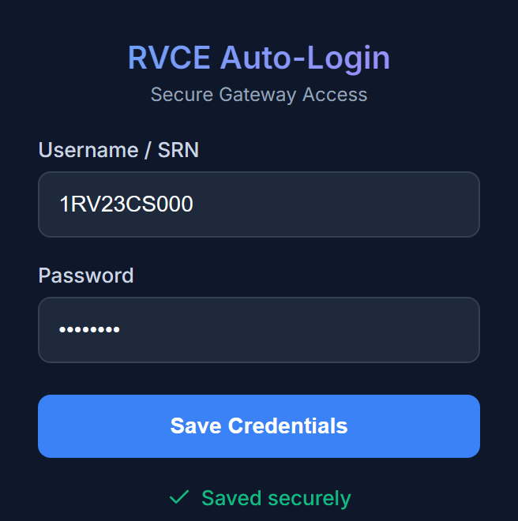

  

<h1 align="center">RVCE Captive Portal Auto-Login</h1>

  A lightweight Chrome extension that logs you in to the <b>RV Institutions Secure Internet Access Gateway</b> automatically.

Say goodbye to typing your SRN and password every time you connect to the campus Wi-Fi!

## Installation

The extension isn't on the Chrome Web Store yet, so you install it manually:

1. **Download the extension**
   - [**Download rvce_wifilogin_v4.zip ⬇️⬇️⬇️**](https://github.com/pavannaik2004/rvce-wifi-login/releases/download/zip-file/rvce_wifilogin_v4.zip)
   - Extract the zip to a folder you won't delete (Chrome loads the extension from this folder every time).

2. **Open the extensions page**
   - Type `chrome://extensions/` in the address bar and press **Enter**.

3. **Turn on Developer mode**
   - Switch on **Developer mode** in the top-right corner.

4. **Load the extension**
   - Click **Load unpacked** in the top-left corner.
   - Select the extracted folder (the one that contains `manifest.json`).

5. **Pin it (recommended)**
   - Click the puzzle-piece icon (🧩) in the toolbar.
   - Click the pin icon (📌) next to **RVCE Auto-Login**.

## How to Use

1. **Open the popup.** Click the RVCE Auto-Login icon in your toolbar.

   

2. **Enter your credentials.** Type your **Username / SRN** and **Password**.

3. **Save.** Click **Save Credentials**. A green **Saved securely** message confirms it.

   

4. **Connect to the campus Wi-Fi.** When the login page (`172.16.0.2:1003`) opens, the extension fills in your details and signs you in automatically.

5. **Keep the session tab open.** After login the gateway shows a Session Monitor page. The extension reloads it every 30 minutes so your session doesn't expire. If you close that tab, the keepalive stops.

To change your credentials later, open the popup, enter the new ones and click **Save Credentials** again.

## Features

- **Zero-Click Login**: Fills in and submits the login form as soon as the portal page loads.
- **Session Keepalive**: Reloads the Session Monitor page every 30 minutes to keep you connected.
- **Scoped to the Gateway**: Runs only on the campus login portal (`172.16.0.2:1003`), nowhere else.
- **Privacy First**: Credentials are stored locally with `chrome.storage.local`. Nothing leaves your device.
- **Infinite-Loop Prevention**: Stops if the portal shows an error such as invalid credentials, so a wrong password won't cause a login loop.
- **Sleek UI**: Dark-mode popup for managing your credentials.

## Security & Privacy

Your credentials are never sent to any external server or telemetry service. They stay in your browser's local extension storage and are only typed into the campus login page. Saving new credentials overwrites the old ones immediately.
