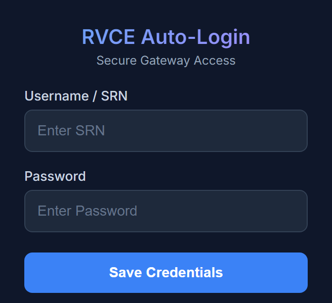
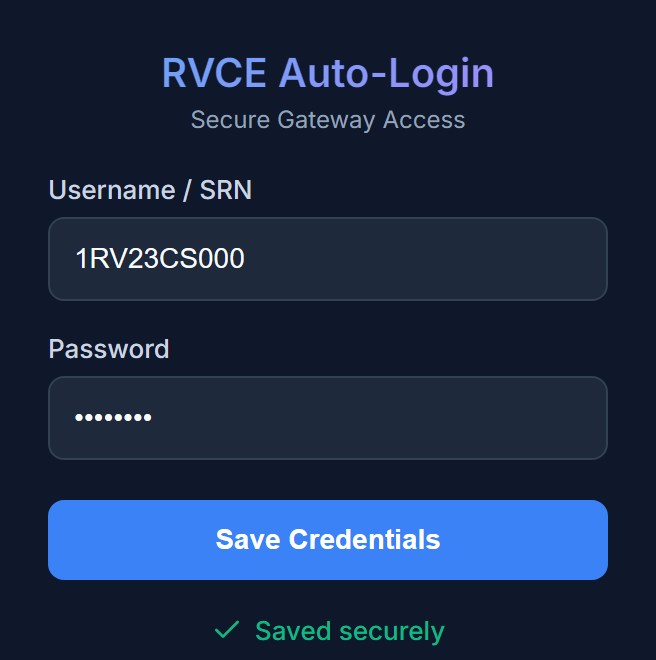

  

<h1 align="center">RVCE Captive Portal Auto-Login</h1>

  A lightweight Chrome extension that logs you in to the <b>RV Institutions Secure Internet Access Gateway</b> automatically.

Say goodbye to typing your SRN and password every time you connect to the campus Wi-Fi!

## Installation

The extension isn't on the Chrome Web Store yet, so you install it manually:

1. **Download the extension**
   - [**Download rvce_wifilogin_v4.zip ⬇️⬇️⬇️**](https://github.com/pavannaik2004/rvce-wifi-login/releases/download/zip-file/rvce_wifilogin_v4.zip)
   - Extract the ZIP to a folder you won't delete (Chrome loads the extension from this folder every time).

2. **Open the extensions page**
   - Type `chrome://extensions/` in the address bar and press **Enter**.

3. **Turn on Developer mode**
   - Switch on **Developer mode** in the top-right corner.

4. **Load the extension**
   - Click **Load unpacked** in the top-left corner.
   - Select the extracted folder (the one that contains `manifest.json`).

5. **Pin it (recommended)**
   - Click the puzzle-piece icon (🧩) in the toolbar.
   - Click the pin icon (📌) next to **RVCE Auto-Login**.

## How to Use

1. **Open the popup.** Click the RVCE Auto-Login icon in your toolbar.

   

2. **Enter your credentials.** Type your **Username / SRN** and **Password**.

3. **Save.** Click **Save Credentials**. A green **Saved locally** message confirms the save operation.

   

4. **Connect to the campus Wi-Fi.** When the login page (`172.16.0.2:1003`) opens, the extension retrieves your credentials from its background service worker, fills in the login form and signs you in automatically.

5. **Keep the session tab open.** After login, the gateway shows a Session Monitor page. The extension reloads it every 30 minutes so your session doesn't expire. If you close that tab, the keepalive stops.

To change your credentials later, open the popup, enter the new ones and click **Save Credentials** again. You can leave the password field empty to retain the previously saved password.

## Features

- **Zero-Click Login:** Fills in and submits the login form as soon as the portal page loads.
- **Session Keepalive:** Reloads the Session Monitor page every 30 minutes to keep you connected.
- **Scoped to the Gateway:** Runs only on the campus login portal (`172.16.0.2:1003`), nowhere else.
- **Encrypted Local Credential Storage:** Encrypts passwords using AES-256-GCM before storing them locally.
- **Non-Extractable Encryption Key:** Uses the Web Crypto API to generate a non-extractable AES key stored in extension-origin IndexedDB.
- **Background Credential Management:** Centralizes encryption, decryption, credential migration and access through the Manifest V3 service worker.
- **Restricted Storage Access:** Limits Chrome local storage access to trusted extension contexts, preventing content scripts from directly accessing stored credentials.
- **Password Field Protection:** Does not display the previously saved password when reopening the popup.
- **Automatic Legacy Migration:** Migrates previously stored plaintext passwords to encrypted storage and removes the old plaintext entry after successful encryption.
- **Infinite-Loop Prevention:** Stops if the portal shows an error such as invalid credentials, so a wrong password won't cause a login loop.
- **Sleek UI:** Dark-mode popup for managing your credentials.

## Security & Privacy

### Credential Storage

- The username is stored locally using Chrome's `chrome.storage.local` API.
- The password is encrypted using **AES-256-GCM** before being stored.
- Encryption and decryption are handled by the extension's background service worker.
- A non-extractable AES-256 encryption key is stored in extension-origin IndexedDB using the Web Crypto API.
- A fresh, randomly generated 96-bit initialization vector (IV) is used for every password encryption.
- The plaintext password is removed from Chrome extension storage after successful encryption.
- The popup never loads the saved password into its password field or receives the decrypted password.

### Threat Model and Limitations

Encryption at rest helps protect against casual inspection of the password in Chrome extension storage.

However, this extension is not a replacement for a dedicated password manager.

An attacker with sufficient access to the computer, browser profile or running extension may be able to invoke the extension's decryption functionality or access credentials while they are in use.

The non-extractable key cannot be exported through the Web Crypto API, but this does not prevent authorized code running in the extension context from using it.

The password must eventually be supplied to the gateway login page for authentication. Consequently, a compromised login page or computer may expose the password while it is being used.

**Important:** If the IndexedDB encryption key is lost or the extension's IndexedDB data is deleted, previously encrypted passwords cannot be recovered. The user will need to enter and save the password again.

### Privacy

- Credentials are not intentionally transmitted to third-party analytics or telemetry services.
- Credentials are submitted to the RVCE gateway when authentication takes place.
- The extension uses local Chrome extension storage and IndexedDB for credential management.
- The extension does not provide protection against malware, a compromised browser profile or a compromised device.

### Recommendations

- Use a unique password for your campus account.
- Protect your computer and browser profile.
- Avoid saving credentials on shared or untrusted computers.
- Keep the extension's files and browser installation up to date.
- Do not share your browser profile with other users.

**Security limitation:** This extension provides encrypted local credential storage for convenience. It is not designed to protect credentials against an attacker who has full control of your computer or browser profile.

## Technology Stack

- JavaScript
- Chrome Extension Manifest V3
- Chrome Storage API
- IndexedDB
- Web Crypto API (AES-256-GCM)